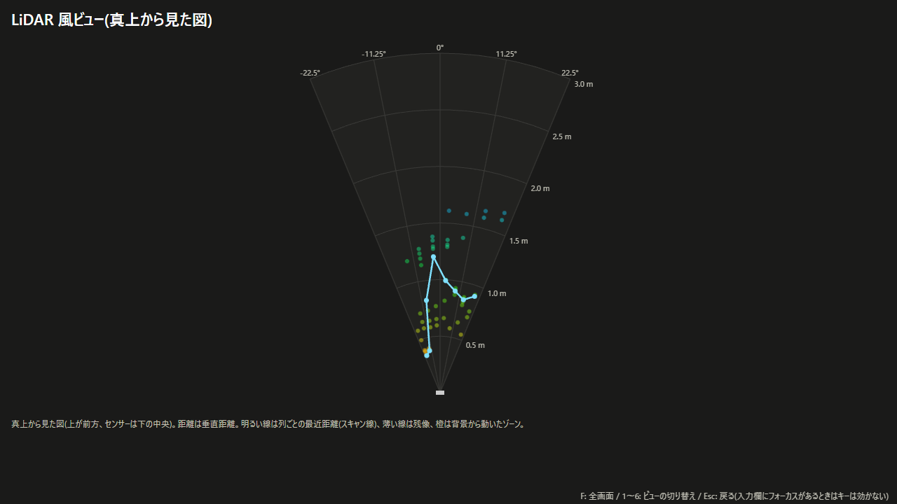
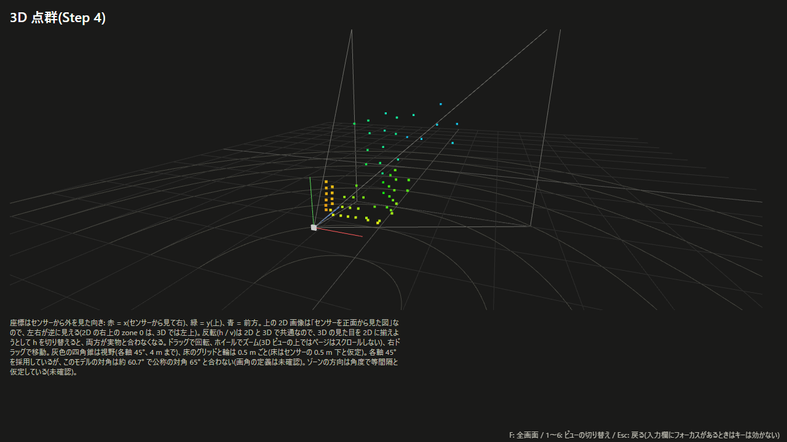

# xiao-vl53l8cx-bootcamp

Seeed Studio XIAO RP2040 と ST VL53L8CX(8x8 マルチゾーン ToF センサー)で、「LiDAR っぽい」技術デモを作る。段階的な課題(Step)を積み上げ、最後に 1 本のデモにまとめた。マイコンは測距フレームを USB シリアルで送り、PC のブラウザ(Web Serial API + three.js)で可視化する。





(画像は同梱のデモ記録を再生して撮ったもの)

## 特徴

- **ターミナル表示**: 8x8 / 15 Hz の距離画像を、ANSI 256 色のヒートマップで表示(PuTTY 等)
- **ブラウザ表示**(Chrome / Edge):
  - 距離・signal_per_spad(IR 画像)・有効 SPAD 数の 3 つの 8x8 画像
  - three.js の 3D 点群(視点を回せる。垂直距離 / 半径の解釈を切り替えられる)
  - LiDAR 風ビュー: 真上から見た扇形のスキャン表示、残像、動いたゾーンの強調
  - レクチャー画面: 業務用の走査型 LiDAR との違い(フラッシュ型と走査型、垂直距離と半径など)を説明する 3 パネル
  - プレゼン用の全画面表示、実機なしのデモ再生
- **フレーム形式**: 経路に依存しないペイロード + CRC-32。USB シリアルでは COBS で包む([docs/frame-format.md](docs/frame-format.md))
- ホストで動くロジック(フレームのエンコード、CRC、表示の組み立て、ゾーン → XYZ 変換など)は、SDK や DOM に依存させず単体テストしている(C は Unity、TypeScript は Vitest)

## 段階構成

| Step | 内容 | 学ぶこと |
|---|---|---|
| 1. 測距 | ULD ドライバを RP2040 に移植し、4x4 の距離を USB シリアルに printf | 配線、I2C、ULD のプラットフォーム層、センサーへのファームウェア転送 |
| 2. 距離画像 | 8x8 / 15 Hz にし、測距ステータスと sigma で無効ゾーンを除く。ターミナルに文字でヒートマップを出す | 解像度とレートの関係、測距データの信頼性 |
| 3. PC ヒートマップ | フレームをバイナリで送り、ブラウザでリアルタイムにヒートマップ表示(距離と IR 画像) | シリアルのフレーム設計、Web Serial |
| 4. 点群 | ゾーンの方向と距離から XYZ に変換し、three.js で 3D 点群表示 | ToF の幾何(画角とゾーン中心の方向) |
| 5. 最終デモ | LiDAR 風ビュー、レクチャー画面、プレゼン用の全画面、実機なしのデモ | まとめ |

Step 1〜5 はすべて実装済みで、実機で動作を確認している。確認した項目と結果は [docs/verification.md](docs/verification.md)。

## ハードウェアと配線

- Seeed Studio XIAO RP2040
- Pololu VL53L8CX キャリア基板(#3419)

追加部品(サーボ、ディスプレイ等)は使わない。ブレッドボードで組むので、I2C のクロックは控えめに 400 kHz にしている。

キャリアのピン名は基板のシルクどおり。回路図: https://www.pololu.com/file/0J2031/vl53l8cx-time-of-flight-sensor-schematic.pdf

| キャリア | XIAO RP2040 | 備考 |
|---|---|---|
| VIN | 3V3 | **3V3 から取る**。キャリアのロジック High は VIN の電圧になる(レベルシフタ NXS0108 の外側が VIN)。5V を入れると XIAO の I/O に 5V がかかる |
| GND(9 ピン側・4 ピン側とも) | GND | |
| SDA | D4(GPIO6) | I2C1 |
| SCL | D5(GPIO7) | I2C1 |
| INT | D0(GPIO26) | 割り込み出力。使わなければポーリングで代用できる |
| ~LP | D1(GPIO27) | Low で I2C 通信を止める(キャリア上でプルアップ済み) |
| **SPI/~I2C** | **GND** | **キャリア上でプルアップされていて既定は SPI**。I2C で使うには必ず GND に落とす(隣の GND ピンとジャンパで短絡すればよい) |
| CORE/IOVDD、AVDD | 接続しない | キャリア上の LDO 出力(1.8 V / 3.3 V) |
| MISO、~CS、SYNC | 接続しない | SPI 用と外部同期用 |

- ロジックピンはすべてキャリアのレベルシフタでプルアップされているので、外付けのプルアップは不要
- I2C アドレスは 7 bit で 0x29。Pololu と ST ULD(`VL53L8CX_DEFAULT_I2C_ADDRESS` = 0x52)は 8 bit 表記なので、Pico SDK に渡すときは 1 bit 右シフトする
- D2 / D3(ADC)と SPI0(D8〜D10)は空けておく
- 気になる点: VIN = 3.3 V だと、AVDD の LDO はドロップアウト分だけ 3.3 V を下回る(Pololu の VIN 下限は 3.2 V なので範囲内)。XIAO の 3V3 が測距中の電流(標準 100 mA、ピーク 150 mA)を賄えるかは未確認。動作が不安定なら疑う

## 必要なもの

- ファームウェア: Pico SDK 2.3.1(`PICO_SDK_PATH`)、Arm GNU Toolchain(`arm-none-eabi-gcc`)、CMake、Ninja。picotool はビルド済みのものを `picotool_DIR` で指定しておく
- ホスト側のテスト・整形: `gcc`、`make`(Windows では w64devkit で確認)、`clang-format`
- ブラウザアプリ(`web/`): Node.js(v24 で確認)と npm。表示には Chrome または Edge(Web Serial は Chromium 系のみ)
- Python 3: `make test` がテストベクタの確認とデコーダの自己検査に使う。記録ツールには pyserial が要る(`pip install -r requirements.txt`。`make` の `PYTHON` 変数で使う python を指定できる)

## ビルドと書き込み

コマンドはすべてリポジトリ直下で実行する。

```
make firmware
```

`cmake -S . -B build -G Ninja -DPICO_BOARD=seeed_xiao_rp2040` と `cmake --build build` を実行し、`build/xiao_vl53l8cx_bootcamp.uf2` ができる(CMake を直接使う場合も `-DPICO_BOARD=seeed_xiao_rp2040` を必ず指定する)。

測距モードは既定で autonomous(積分時間 5 ms。ULD の既定値と同じ)。`make firmware BUILD_DIR=build-continuous CMAKE_ARGS=-DBOOTCAMP_RANGING_CONTINUOUS=ON` で continuous、`CMAKE_ARGS=-DBOOTCAMP_INTEGRATION_TIME_MS=15` で積分時間を変えられる([docs/design-notes.md](docs/design-notes.md) の「設計メモ(測距の設定)」)。1 ゾーンあたりのターゲット数(既定 1)は `CMAKE_ARGS=-DBOOTCAMP_TARGETS_PER_ZONE=2` のように 1〜4 で変えられる(同じく「設計メモ(1 ゾーン 2 ターゲット)」)。ターゲットの順は既定で strongest(信号の強い順)で、`-DBOOTCAMP_TARGET_ORDER_CLOSEST=ON` で closest(近い順)にできる。

1. XIAO の B(BOOT)ボタンを押しながら USB で PC に接続する(または接続中に B を押したまま R を押して離す)
2. `RPI-RP2` ドライブが現れるので、`build/xiao_vl53l8cx_bootcamp.uf2` をコピーする。コピーが終わると自動で再起動する
3. 測距が始まると緑 LED が点く。初期化に失敗すると赤 LED が点き、エラーをシリアルに出し続ける

## 使い方

詳細(PuTTY の設定、表示の読み方、各画面の説明)は [docs/usage.md](docs/usage.md)。

### ターミナル表示

XIAO の COM ポートをターミナルソフト(PuTTY 等)で開くと、8x8 の距離画像がカラーのヒートマップで表示される。1 文字のキーで操作する(Enter は不要)。

| キー | 動作 |
|---|---|
| `h` / `H` | 左右反転を切り替える |
| `v` / `V` | 上下反転を切り替える |
| `c` / `C` | カラー(ANSI 256 色、画面を上書き)とモノクロ(ANSI エスケープなし、流れる)を切り替える |
| `?` | ヘルプを表示する |
| `b` / `B` | バイナリの出力に切り替える(ブラウザや記録用) |
| `t` / `T` | バイナリからテキストの表示に戻す |

既定の向き(左右反転あり・上下反転なし)は、**センサーを自分に向けて、キャリアの 9 ピン列が左になるように持ったとき**に見た目と一致する。

### ブラウザ表示

`web/` で次を実行し、Chrome または Edge で http://localhost:5173/ を開く。

```
npm install
npm run dev
```

1. ターミナルソフトで COM ポートを開いていたら閉じる
2. 「接続」を押し、ダイアログで XIAO のポートを選ぶ(アプリがバイナリ出力への切り替えを送る)
3. 「切断」でテキスト表示に戻してから閉じる

Web Serial は secure context(https または localhost)でしか使えない。

- ビュー: `1` LiDAR 風ビュー、`2` 3D 点群、`3` 2D 画像、`4`〜`6` レクチャー A〜C。`F` で選んだビューを全画面にする(`Esc` で戻る)
- 実機なしで見る: 「デモ」のメニューで選んで「ループ再生」。`tools/capture_serial.py` で記録したファイルも「記録ファイルの再生」で再生できる
- URL で開く: 例 `http://localhost:5173/?view=lectureB&demo=step3-sample`
- オフラインで見せる: `npm run build` → `npm run preview`(http://localhost:4173/)。`web/dist/` は任意の静的ファイルサーバーに置ける

## 開発

### ファームウェアとホストのテスト(リポジトリ直下)

| コマンド | 内容 |
|---|---|
| `make format` | clang-format で整形(`include/` `src/` `tests/` のみ。`third_party/` は対象外) |
| `make lint` | 整形済みか検査(差分があれば失敗) |
| `make test` | `src/uld_util.c` / `src/depth_view.c` / `src/frame_proto.c` をホストの gcc でビルドし、Unity のテストを実行。続けて、テストベクタが生成スクリプトと一致するかと、デコーダの自己検査を行う。成果物は `build-host/` |
| `make vectors` | テストベクタ(`docs/frame-vectors.json`、`tests/frame_vectors.h`)を作り直す(`tools/gen_frame_vectors.py` を変えたとき) |
| `make firmware` | ファームウェアのビルド(上記) |

`-Wall -Wextra` は自作のソースだけに付けている(ULD と SDK には付けない)。

### ブラウザアプリ(`web/`)

| コマンド | 内容 |
|---|---|
| `npm run dev` | 開発サーバー(http://localhost:5173/) |
| `npm run build` | 型チェックの後、`web/dist/` に静的ファイルを出力 |
| `npm run preview` | `dist/` をローカルで配って確認 |
| `npm run format` / `format:check` | Prettier で整形 / 整形済みか検査 |
| `npm run lint` | ESLint(typescript-eslint の型情報付きの規則) |
| `npm run typecheck` | `tsc --noEmit` |
| `npm test` | Vitest |

### ツール(リポジトリ直下)

| コマンド | 内容 |
|---|---|
| `python tools/capture_serial.py --port COM7 --seconds 5 --out capture.bin` | バイナリの出力を記録する |
| `python tools/verification/decode_capture.py capture.bin` | 記録をデコードして統計(メッセージ数、fps、seq の欠落、拒否の数など)を出す |
| `python tools/verification/verify_depth_view_expected_values.py` | depth_view のテストの期待値を検算する |
| `python tools/verification/estimate_ranging_read_time.py` | 1 フレームの読み出しバイト数と I2C の転送時間を見積もる |

## ドキュメント

- [docs/usage.md](docs/usage.md) — 使い方の詳細(PuTTY の設定、表示の読み方、ブラウザの各画面、デモの追加方法)
- [docs/frame-format.md](docs/frame-format.md) — PC へ送るバイナリメッセージの形式(版 1)
- [docs/frame-vectors.json](docs/frame-vectors.json) — 形式のテストベクタ(`tools/gen_frame_vectors.py` が生成)
- [docs/design-notes.md](docs/design-notes.md) — 設計メモ(決定事項、ファイル構成、各 Step の設計判断と見積もり)
- [docs/verification.md](docs/verification.md) — 実機での確認項目と結果
- [tests/CASES.md](tests/CASES.md) — ホストで単体テストする部分の入力と期待値
- [third_party/vl53l8cx_uld/README.md](third_party/vl53l8cx_uld/README.md) — ULD の出どころと差し替えたファイル

## ライセンス

[MIT](LICENSE)。ただし `third_party/` 以下はそれぞれのライセンスに従う。

- `third_party/vl53l8cx_uld/`: STMicroelectronics VL53L8CX ULD(STSW-IMG040 v2.0.1)— BSD-3-Clause([LICENSE.txt](third_party/vl53l8cx_uld/LICENSE.txt))
- `third_party/unity/`: Unity — MIT([LICENSE.txt](third_party/unity/LICENSE.txt))
